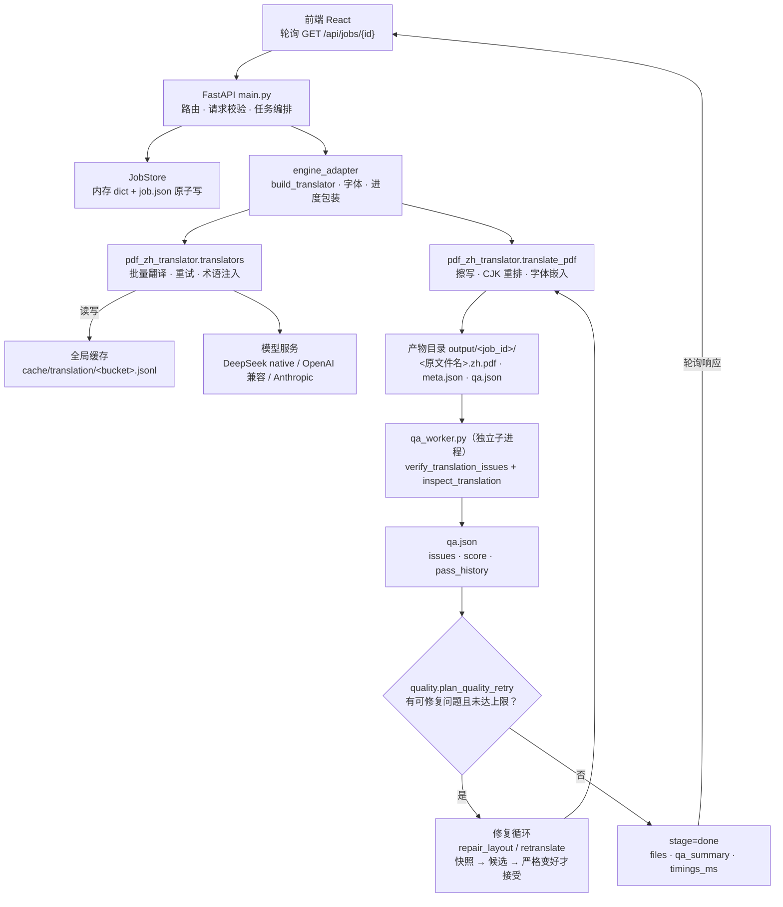
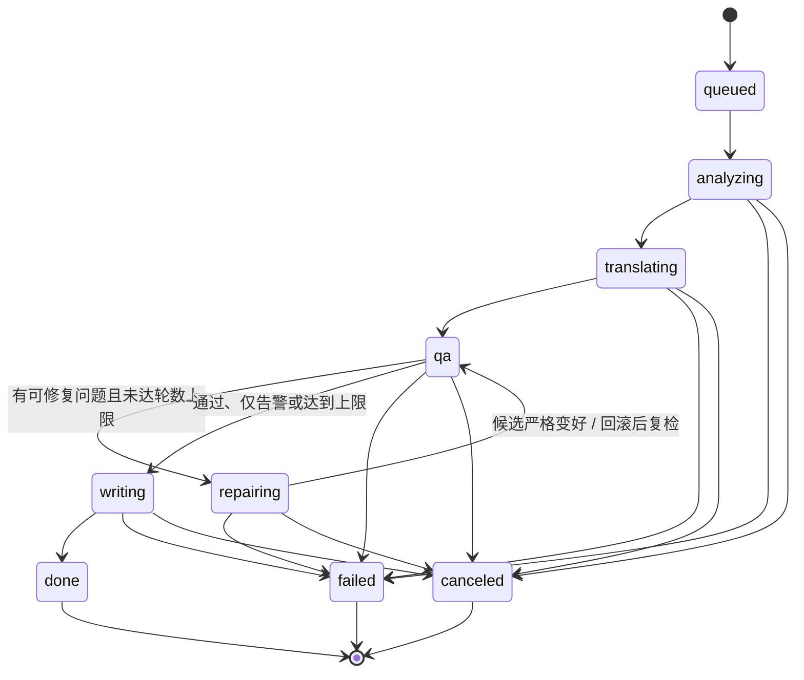

# 架构设计

本文描述 paperex v1.2.0 的分层、数据流、关键模块与持久化设计。目标读者是希望修改引擎、扩展协议或排查问题的开发者。

## 1. 总览

paperex 由三个进程/层次组成，全部运行在本机：

```text
┌────────────────────────────────────────────────────────────────────┐
│ 前端（React 18 + Vite）                                             │
│  浏览器预览：http://127.0.0.1:1420                                  │
│  桌面端：Tauri 2 WebView（Windows 为 WebView2），内嵌 frontend/dist │
└───────────────┬────────────────────────────────────────────────────┘
                │ REST / JSON，轮询任务状态（仅 127.0.0.1:8756）
┌───────────────▼────────────────────────────────────────────────────┐
│ FastAPI 后端（backend/main.py）                                     │
│  - 路由 / 任务编排 / 进度与状态 / 历史 / 文件沙盒 / 配置             │
│  - JobStore：内存 dict + job.json 原子写（v1.1）                     │
│  - 引擎串行锁 _ENGINE_LOCK：同一时刻只运行一个翻译任务               │
└───────┬──────────────────────────────────────────┬─────────────────┘
        │ 进程内调用                                │ 独立子进程（v1.1）
┌───────▼─────────────────────────────┐   ┌────────▼─────────────────┐
│ 引擎（backend/pdf_zh_translator/）    │   │ QA worker（qa_worker.py） │
│  - 结构分析 / 保护区 / 擦写 / CJK 重排 │   │ - verify + inspect       │
│  - translators.py：模型协议与重试      │   │ - 超时/崩溃不影响主任务   │
│  - corpus.py：1066 条术语             │   │ - 输出 qa.json           │
└───────────────────────────────────────┘   └──────────────────────────┘
                │
        ┌───────▼─────────────────────────────┐
        │ 模型服务（用户选择）                  │
        │  DeepSeek native / OpenAI 兼容 /      │
        │  Anthropic Messages                   │
        └───────────────────────────────────────┘
```

设计约束：

- **只监听回环地址**：`127.0.0.1:8756`，不暴露局域网；CORS 允许本地前端来源。
- **文件沙盒**：前端只能请求 `%APPDATA%/paperex/` 下的相对路径，`ensure_inside()` 拦截路径穿越；上传大小上限 120 MB。
- **无云服务**：仓库没有 paperex 自己的服务端；API Key 与论文内容只存在于本机与用户选择的模型服务商之间。
- **单一任务串行**：引擎包含文档级全局状态（PyMuPDF 文档对象、字体缓存），`_ENGINE_LOCK` 保证同一时刻只有一个 `translate_pdf` 在跑；后续任务排队并暴露 `queue_position`。

## 2. 分层与关键文件

| 层 | 路径 | 职责 |
| --- | --- | --- |
| 桌面壳 | `frontend/src-tauri/src/lib.rs` | 启动时探测 `127.0.0.1:8756`；未运行则用项目 `.venv/python.exe` 拉起 `uvicorn main:app`（`CREATE_NO_WINDOW`，`PYTHONUTF8=1`）；`BackendGuard` 在 `RunEvent::Exit` 时 kill 子进程；向上查找 `backend/` 目录；暴露 `backend_base()` 命令 |
| 桌面壳配置 | `frontend/src-tauri/tauri.conf.json` | 窗口 1500×950、最小 1100×700、`frontendDist: ../dist`、`devUrl: http://127.0.0.1:1420`、bundle icon |
| 前端入口 | `frontend/src/main.jsx` | 挂载 React 根组件 |
| 前端 UI | `frontend/src/App.jsx` + `frontend/src/components/` + `frontend/src/hooks/` + `frontend/src/lib/` | 顶层状态与视图组合：首页/历史、阅读器、设置弹窗、QA 抽屉、进度与错误态；`isTauri` 检测与原生文件对话框；任务轮询 |
| 前端常量 | `frontend/src/constants.js` | `THEMES`（六主题）、`MODES`、API base 等常量 |
| 前端存储 | `frontend/src/lib/storage.js` | `localStorage` 读写封装与版本迁移 |
| 样式 | `frontend/src/index.css` | Tailwind 指令、主题变量、阅读器/滚动条样式 |
| HTTP 层 | `backend/main.py` | FastAPI 应用、`ConvertRequest` 校验、任务编排 `run_job()`、历史、上传、文件流、健康检查 |
| 引擎适配 | `backend/engine_adapter.py` | 字体发现与选择、模型协议路由（`build_translator` / `build_vendor_translator`）、进度包装、QA 摘要、字体子集化、错误文案 |
| 引擎核心 | `backend/pdf_zh_translator/pdf_layout.py` | `prepare_translation_units()`（结构分析）、`translate_pdf()`（擦写 + 回填 + 重排）、`verify_translation_issues()`（文本对象级 QA） |
| 页面质检 | `backend/pdf_zh_translator/page_inspector.py` | 页面级视觉 QA：`inspect_translation()`，重叠/越框/表格塌陷/字号漂移 |
| 版面画像 | `backend/pdf_zh_translator/layout_profiles.py`、`layout_families.py`、`journal_layout.py` | 识别 ICLR / NeurIPS / ACL / Springer / Nature 等版式族与期刊专用排版规则 |
| 模型协议 | `backend/pdf_zh_translator/translators.py` | OpenAI 兼容 / DeepSeek native / Anthropic Messages 三种协议，批量翻译与重试 |
| 术语库 | `backend/pdf_zh_translator/corpus.py`、`corpus.json` | 内置 1066 条术语、匹配与注入、冲突检测 |
| OCR | `backend/pdf_zh_translator/ocr.py` | 文本层检测与可选 Tesseract 预处理（不捆绑 Tesseract） |
| 视觉工具 | `backend/pdf_zh_translator/visual_qa.py` | 渲染页面对比、墨迹/布局评分等底层能力 |
| 公式辅助 | `backend/pdf_zh_translator/formula_accessibility.py`、`task_formula_layout.py`、`editable_figures.py` | 公式区域判定、图文保护、可编辑图形处理 |
| 命令行 | `backend/pdf_zh_translator/cli.py`、`__main__.py` | 引擎独立 CLI（离线批处理/调试） |
| 质量逻辑（v1.1） | `backend/quality.py` | 纯函数：issue 分类、`issue_fingerprint`、`plan_quality_retry`、strict gate、评分比较 |
| QA 隔离（v1.1） | `backend/qa_worker.py` | 独立进程执行 QA，读写 spec.json/qa.json，超时与崩溃隔离 |
| 测试 | `backend/tests/` | `test_engine_offline.py`、`test_api_dryrun.py`、v1.1 新增 `test_quality.py` / `test_api_contract.py` / `test_jobs.py` / `test_cache.py` / `test_qa_worker.py` / `test_engine_regression.py` |

> 引擎目录是自 super_translate 移植并修改的代码，行数与复杂度都很高（`pdf_layout.py` 约 3.6 万行 / 1.4 MB）。修改前请先读 [QUALITY.md](QUALITY.md) 与 `pdf_layout.py` 顶部的设计注释。

## 3. 数据流



1. **选文件**：桌面端由 `@tauri-apps/plugin-dialog` 返回绝对路径；浏览器端 `POST /api/upload` 把文件写入 `%APPDATA%/paperex/uploads/`，返回沙盒内路径。
2. **结构分析**：`prepare_translation_units()` 读取文本块与绘图对象，按版面 profile 分类角色；判定保护区（公式、表格、图片内文字、算法、参考文献、页眉页脚）。输出页数、可翻译块、保护区块数、字符数。
3. **翻译**：`build_translator()` 依据 `base_url / model` 选择协议（`resolve_vendor_mode`），包装进度回调；`translate_pdf()` 按批次索取译文（术语注入 + 占位符校验 + 失败阶梯重试 + 全局缓存），擦除可替换文字层，用 LXGW 字体在原始 bbox 内回填中文（断行、禁则、两端对齐、字号自适应）。
4. **收尾**：字体处理（`preserve_graphics_text` 时保留源字体，避免破坏公式/图表字形）；生成 `meta.json`。
5. **译后 QA**：`verify_translation_issues()`（文本对象级）+ `page_inspector.inspect_translation()`（页面级视觉）在 `qa_worker.py` 子进程中运行，写出 `qa.json`。
6. **修复循环**（v1.1）：`quality.plan_quality_retry()` 依据 issue 分类与评分决定 `repair_layout` / `retranslate` / 停止；每轮保存快照，候选必须严格变好才接受，否则回滚。
7. **完成**：写 `job.json` / `qa.json`；前端下一次轮询拿到 `stage=done` 与 `files.{original_url,translated_url}`。

## 4. 任务状态机（v1.1）



- `stage` 是细粒度阶段（`queued / analyzing / translating / qa / repairing / writing / done / failed / canceled`），前端进度卡与 ETA 都基于它；`status` 是任务状态（`queued / running / done / error / cancelling / cancelled`），终态映射为 `done → stage=done`、`error → stage=failed`、`cancelled → stage=canceled`。
- `progress` 是 0–1 的总进度；`pages_done / pages_total`、`eta_seconds`、`quality_round{current,max,status}`、`queue_position` 为附加信息。
- **取消**：`POST /api/jobs/{id}/cancel` 设置取消标志，翻译循环在块边界与请求边界检查并抛出 `JobCanceled`；状态先置 `cancelling`，清理产物后置 `status=cancelled / stage=canceled`。
- **持久化**：JobStore 内存 dict 是权威状态，每次状态变化原子写 `jobs/<job_id>/job.json`；后端启动时按 `PAPEREX_RESUME_JOBS=1` 恢复未完成任务（标记为可重试/中断）。
- **心跳**：任务每 60 s 更新心跳；超时未更新置 `status=error / stage=failed`，`error_detail.code=interrupted`、`retryable=true`。

## 5. 前端结构

`frontend/src/App.jsx` 是顶层容器（状态与轮询编排），视图与基础组件已拆分到 `frontend/src/components/`、`frontend/src/hooks/`、`frontend/src/lib/`：

| 组件（`components/`） | 作用 |
| --- | --- |
| `App` | 顶层状态：当前视图、任务轮询（`hooks/useJobPolling.js`）、设置、主题、错误处理；判断 `isTauri` |
| `HomePage` | 「我的论文翻译」列表、拖拽/上传、删除、空状态、演示标签 |
| `Sidebar` | 导航、后端在线状态、历史缩略、设置入口、深浅色切换 |
| `Reader` / `PdfPane` / `PageSlot` | 双栏阅读器；单侧 PDF 渲染（react-pdf），懒加载页面、缩放、与滚动同步（`hooks/usePdfSync.js`） |
| `SettingsModal` | 服务地址 / 模型 / API Key、测试连接、质量模式、主题、缓存统计 |
| `QaPanel` | QA 摘要徽标 + 抽屉：按严重度分组的 issue 列表、搜索、页码跳转、原始 JSON |
| `LoadingOverlay` | 阶段文案、百分比、ETA、质量轮次、取消按钮 |
| `ErrorCard` / `ErrorBoundary` | 把后端 `error_code` 映射为中文说明与操作建议；渲染异常兜底 |
| `HelpDialog` / `Icon` | 帮助弹窗与内联 SVG 图标（无图标库依赖） |

- **通信**：`fetch` 轮询 `GET /api/jobs/{id}`（间隔数百毫秒到 1 秒），不做 WebSocket；后端只提供 REST。
- **配置**：保存于本机 `localStorage`（`paperex.*`），API Key 不进入仓库、不写日志。
- **URL 参数（v1.1，仅演示/调试）**：`?demo=home|progress|error|qa|reader`、`?view=settings|qa|help`、`?theme=<id>&mode=dark|light`、`?apiBase=http://127.0.0.1:9999`。演示态不依赖后端，用于截图与 UI 回归。
- **桌面端差异**：原生文件对话框、`backend_base()` 命令、窗口关闭时后端随壳退出；浏览器端走上传接口。

## 6. 引擎关键入口

```python
# 结构分析
from pdf_zh_translator.pdf_layout import prepare_translation_units
units = prepare_translation_units(pdf_path)

# 翻译 + 擦写 + 重排
from pdf_zh_translator.pdf_layout import translate_pdf
report = translate_pdf(
    src_path, out_path, translator,
    font_file=regular_ttf, bold_font_file=bold_ttf,
    min_font_size=6.0, font_scale=0.90, margin=0.8,
    preserve_graphics_text=True, harmonize_body_font_size=True,
)

# 文本对象级 QA
from pdf_zh_translator.pdf_layout import verify_translation_issues
issues = verify_translation_issues(src_path, out_path)

# 页面级视觉 QA
from pdf_zh_translator.page_inspector import inspect_translation
issues = inspect_translation(src_path, out_path)
```

翻译器构造（`backend/engine_adapter.py`）：

```python
from engine_adapter import build_translator
translator = build_translator(
    base_url="https://api.deepseek.com/v1",
    api_key="sk-...",
    model="deepseek-flash",
    timeout=150.0,
    cache_path=job_dir / "translation-cache.jsonl",
    progress_callback=on_progress,
    concurrency=6,
    dry_run=False,
)
```

`build_translator` 会按 `resolve_vendor_mode(base_url, model)` 选择协议：`deepseek-flash` / `deepseek-v4*` 走 native，`api.anthropic.com` 走 Messages，其余走 OpenAI 兼容。`ProgressTranslator` 包装批量调用，按块回调进度并在取消时抛 `JobCanceled`（v1.1）。

## 7. 持久化与缓存

```text
%APPDATA%\paperex\
├── output\<job_id>\
│   ├── source.pdf / <原文件名>.zh.pdf   # 源副本 / 译文
│   ├── meta.json                        # 历史列表条目
│   ├── qa.json                          # QA 报告
│   ├── translation-cache.jsonl          # 本任务写入的缓存记录（调试用）
│   ├── .qa\...                          # QA 子进程中间结果（*.json / *.spec.json）
│   └── .snapshots\round-<n>\...         # 质量循环每轮快照
├── jobs\<job_id>\job.json               # 完整任务状态（用于恢复）
├── cache\translation\<bucket>.jsonl     # 全局翻译缓存
├── fonts\                               # 用户自定义字体（优先级最高）
└── uploads\                             # 浏览器上传临时文件
```

- **JobStore**：`JOBS: dict[job_id, dict]` 是内存权威状态；`_persist_job()` 以「临时文件 + `os.replace`」原子写 `%APPDATA%/paperex/jobs/<job_id>/job.json`，避免崩溃产生半截 JSON。
- **历史**：`GET /api/history` 读取每个 `output/<job_id>/meta.json`；无 `job.json` 的旧任务按 v1.0 逻辑兜底。
- **缓存桶**：`bucket = sha256(protocol|api_url|model|source_lang|target_lang|engine_revision|prompt_version|terms_fingerprint)[:16]`，写入 `%APPDATA%/paperex/cache/translation/<bucket>.jsonl`；`PAPEREX_CACHE_MAX_MB`（默认 500）控制上限，超出按 LRU 清理。每个 job 另写一份任务级缓存，便于审计。
- **为什么缓存键包含引擎版本与术语指纹**：引擎提示词或术语变化会改变译文，旧缓存必须失效，否则会出现「同样输入、不同译文」的不可复现问题。

## 8. 质量循环的实现划分

| 文件 | 进程 | 职责 | 约束 |
| --- | --- | --- | --- |
| `backend/quality.py` | 主进程 | 纯逻辑：分类、指纹、评分、`plan_quality_retry`、strict gate | 不 import PyMuPDF、不做 IO，便于单测（`test_quality.py`） |
| `backend/qa_worker.py` | 子进程 | 读 `spec.json`（源/译文路径、检测器开关、`max_pages`），跑 verify + inspect，写 `qa.json` | 默认超时 600 s（`qa.DEFAULT_TIMEOUT_S`）；崩溃/超时只记 `qa_failed`，不改变任务成功状态。注意：引擎的 `pages` 子集参数尚未接入 worker，复检仍整篇运行 |
| `backend/main.py` | 主进程 | 调度修复轮次、保存快照、接受/回滚、更新 `stage` | 每轮 QA 后比较 `candidate_score`，严格变小才接受 |

**为什么隔离**：`inspect_translation()` 会渲染整页图像，CPU/内存开销大且偶发崩溃；放进子进程后可用超时强杀，QA 失败降级为 warning，不会让已经成功的翻译任务失败。

**为什么严格变好才接受**：修复动作可能引入新问题（重排版挤压其他段落、重译改变术语）。用 `(error_count, issue_count)` 字典序评分 + issue 指纹比较，候选只在严格变好时采纳，否则回滚到上一轮快照，保证「质量循环不会让结果更差」。

## 9. 设计权衡与决策记录

| 决策 | 理由 |
| --- | --- |
| 原位擦写而非双页并排输出 | 产物仍是标准 PDF，可检索/批注/打印；阅读器里再提供左右对照 |
| 保护区（表格/参考文献保留英文） | 表格单元格与文献条目重排极易破坏版式；保留英文是版式保真策略，图注仍翻译 |
| 任务串行 + 引擎锁 | PyMuPDF 文档级全局状态与字体缓存不支持并发；串行换取稳定与可复现 |
| QA 隔离子进程 | 可超时/可崩溃隔离；QA 失败不阻塞翻译 |
| 质量循环默认 `standard` | 大多数任务 1 轮内收敛；`off` / `fast` 可按需降级 |
| 全局缓存按「引擎+术语指纹」分桶 | 保证可复现：同输入同输出，变更即失效 |
| 前端组件拆分 | v1.0 为单文件 App.jsx；v1.1 已拆出 `components/`（Reader/QaPanel/SettingsModal 等）与 `hooks/`、`lib/`，便于截图演示态与后续维护 |
| API v1.1 向后兼容 | 旧前端/脚本无需改动；新字段只增不改 |

## 10. 扩展指南

- **新增模型服务**：在 `translators.py` 添加协议实现，在 `engine_adapter.resolve_vendor_mode()` 注册路由，在 `GET /api/models` 的目录里补条目；缓存桶会因 `protocol` 变化自动隔离。
- **新增 QA 检测器**：在 `verify_translation_issues()` / `inspect_translation()` 产出 issue（必须带 `page / code / message / severity`）；在 `quality.py` 的 `LAYOUT_REPAIR_ISSUE_CODES` 或 `RETRANSLATABLE_ISSUE_CODES` 注册可修复动作，否则默认只报告。
- **新增修复动作**：在 `quality.py` 规划分支增加动作，在 `main.py` 的修复执行器中实现，并保证可回滚（快照）与可评分。
- **前端新阶段**：后端 `stage` / `stage_label` 增加枚举，前端 `LoadingOverlay` 与错误卡映射同步更新；
- **截图/演示态**：使用 `?demo=` URL 参数，不要在后端造 mock 数据。

相关文档：[QUALITY.md](QUALITY.md)、[DEVELOPMENT.md](DEVELOPMENT.md)、[ROADMAP.md](ROADMAP.md)。
